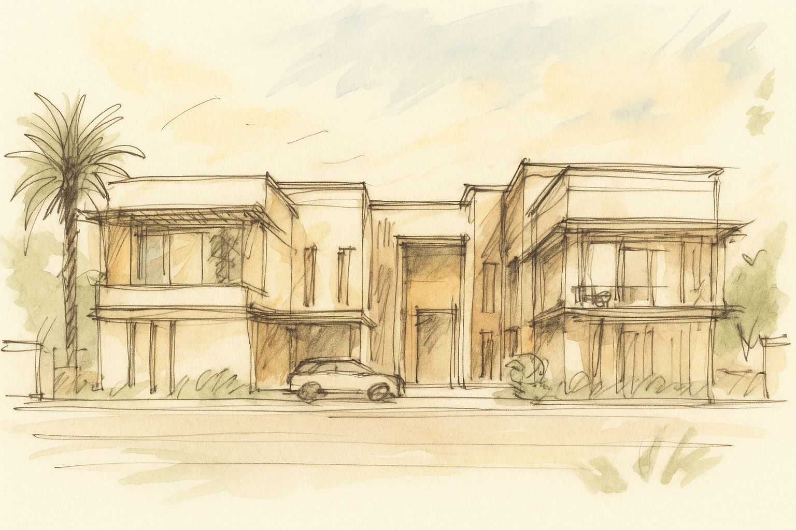

A unique family retreat designed for special private gatherings, relaxation, and rejuvenation was what our client envisioned for their Palm Jumeirah home. Combining two residences into a single expansive home makes it a distinctive offering for the area. The desired design incorporates a variety of dedicated family social spaces with a strong emphasis on wellness.

Zoya embodies a deep sense of place and tradition, establishing a lasting connection to the Arabian Peninsula and creating a welcoming sanctuary for family bonding and cherished memories. Inspired by the gentle ripples of seawater on the beach, the design incorporates stepped angular terraces that allow for uninterrupted views of the sky. Each terrace is a perfect spot for sunbathing during the day and stargazing at night.

